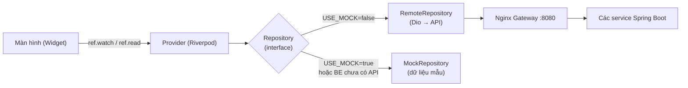
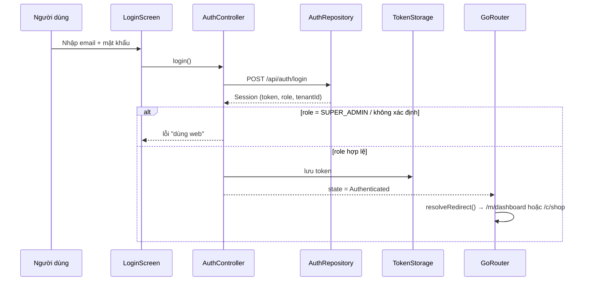

# Kiến trúc app

Tài liệu này giải thích **code nằm ở đâu, chạy như thế nào và thêm chức năng mới ra sao**. Viết cho người mới làm Flutter.

## 1. Bức tranh tổng thể



- **Màn hình** chỉ lo hiển thị và nhận thao tác. Không gọi API trực tiếp.
- **Provider** (Riverpod) giữ dữ liệu/trạng thái và cung cấp repository cho màn hình.
- **Repository** là "cửa" lấy dữ liệu. Mỗi repository có 1 interface (domain) + 2 bản cài đặt: **Remote** (gọi API thật) và **Mock** (dữ liệu giả).
- Đổi giữa thật/giả chỉ bằng cờ `USE_MOCK` - màn hình **không phải sửa**.

## 2. Cấu trúc thư mục

```
lib/
├── main.dart                 # = dev, dùng khi chạy `flutter run` không chỉ -t
├── main_dev.dart             # môi trường dev  (mock bật mặc định)
├── main_staging.dart         # môi trường staging
├── main_prod.dart            # môi trường production
│
├── app/
│   ├── bootstrap.dart        # khởi động: tạo AppConfig, bọc ProviderScope
│   ├── app.dart              # MaterialApp.router: theme, ngôn ngữ, router
│   ├── config/app_config.dart# Flavor, API_BASE_URL, USE_MOCK
│   ├── router/
│   │   ├── routes.dart       # TẤT CẢ đường dẫn + hàm resolveRedirect (phân quyền)
│   │   ├── app_router.dart   # khai báo GoRouter
│   │   └── shells.dart       # thanh điều hướng dưới cho Merchant / Customer
│   └── theme/app_theme.dart  # màu sắc, kiểu chữ (tạm thời)
│
├── core/                     # dùng chung, KHÔNG phụ thuộc feature cụ thể (trừ mock_data)
│   ├── auth/                 # UserRole, Session, JwtDecoder
│   ├── network/              # Dio + AuthInterceptor, ApiException, unwrapResponse, PageResult
│   ├── storage/              # TokenStorage (secure storage)
│   ├── models/               # model dùng chung (Platform: Shopee/TikTok)
│   ├── mock/mock_data.dart   # dữ liệu mẫu
│   ├── utils/                # Formatters (₫, ngày), Validators, MockDelay
│   └── widgets/              # AsyncValueView, ErrorView, EmptyView, MockDataBanner...
│
├── features/                 # mỗi thư mục = 1 chức năng
│   ├── auth/                 # đăng nhập, quên mật khẩu, AuthController (phiên)
│   ├── dashboard/            # Merchant: tổng quan
│   ├── orders/               # Merchant: đơn hàng
│   ├── products/             # Merchant: sản phẩm
│   ├── inventory/            # Merchant: tồn kho
│   ├── ai_insights/          # Merchant: dự báo AI
│   ├── marketplace/          # Tenant Admin: kết nối sàn
│   ├── merchant_more/        # Merchant: tab "Thêm"
│   ├── storefront/           # Customer: xem sản phẩm, mua trên sàn
│   ├── loyalty/              # Customer: điểm, hạng, voucher, claim đơn
│   └── account/              # Customer: tài khoản; widget hồ sơ/đăng xuất dùng chung
│
└── l10n/                     # app_vi.arb, app_en.arb (+ generated/ tự sinh, không commit)
```

Mỗi feature chia 3 lớp:

| Lớp | Chứa gì | Ví dụ |
|---|---|---|
| `domain/` | Model + interface repository + **quy tắc nghiệp vụ** (thuần Dart, dễ test) | `order.dart`, `loyalty_rules.dart` |
| `data/` | Cài đặt repository: Remote (Dio) và Mock | `orders_repositories.dart` |
| `presentation/` | Provider + màn hình + widget | `orders_providers.dart`, `orders_screen.dart` |

## 3. Riverpod trong 5 phút

Riverpod = cách "đăng ký" và "lấy" dữ liệu ở bất kỳ đâu trong app.

```dart
// 1) Khai báo provider (thường ở presentation/xxx_providers.dart)
final ordersPageProvider = FutureProvider.autoDispose<PageResult<Order>>(
  (ref) => ref.watch(ordersRepositoryProvider).fetchOrders(),
);

// 2) Dùng trong màn hình: kế thừa ConsumerWidget, nhận thêm `ref`
class OrdersScreen extends ConsumerWidget {
  @override
  Widget build(BuildContext context, WidgetRef ref) {
    final orders = ref.watch(ordersPageProvider); // AsyncValue: loading / error / data
    return AsyncValueView(
      value: orders,
      onRetry: () => ref.invalidate(ordersPageProvider), // tải lại
      data: (page) => ListView(...),
    );
  }
}
```

| Hàm | Khi nào dùng |
|---|---|
| `ref.watch(p)` | Trong `build`, muốn màn hình **tự vẽ lại** khi dữ liệu đổi |
| `ref.read(p)` | Trong hàm xử lý sự kiện (bấm nút) - chỉ đọc 1 lần |
| `ref.invalidate(p)` | Bắt provider tải lại dữ liệu (sau khi thêm/sửa) |
| `ref.listen(p, ...)` | Làm việc phụ khi dữ liệu đổi (hiện SnackBar, điều hướng) |

Loại provider đang dùng:
- `Provider` - giá trị cố định/được tính (repository, config).
- `FutureProvider` - dữ liệu tải bất đồng bộ (danh sách đơn). `.autoDispose` = tự hủy khi rời màn hình. `.family` = có tham số (id).
- `NotifierProvider` - trạng thái có hành động (AuthController: login, logout).

## 4. Đăng nhập và phân quyền theo role



- `AuthController` (features/auth/presentation) giữ `AuthState`: `AuthUnknown` (đang đọc token) → `Unauthenticated` / `Authenticated(session)`.
- Khi mở app: đọc token đã lưu → giải mã JWT → còn hạn thì vào thẳng trang chủ.
- `GoRouter` lắng nghe `AuthState`; mỗi lần đổi sẽ chạy `resolveRedirect()` trong `routes.dart`:
  - chưa đăng nhập → `/login`
  - Customer chỉ được vào `/c/...`, Staff/Admin chỉ `/m/...`
  - Staff không vào được route của Tenant Admin (`Routes.tenantAdminOnly`)
- Server trả **401** → `AuthInterceptor` phát sự kiện → `AuthController` xóa token → về login kèm thông báo "Phiên hết hạn".

## 5. Gọi API

- `dioProvider` (core/network/api_client.dart): base URL từ `AppConfig`, timeout, tự gắn `Authorization: Bearer`, log request khi debug.
- Backend luôn trả `{ success, message, data, timestamp }` → dùng `unwrapResponse(res.data, parse)`.
- Danh sách phân trang Spring → `PageResult.fromJson(data, Item.fromJson)`.
- Mọi lỗi được chuyển thành `ApiException` (có `type` và `message` tiếng Việt) → UI chỉ cần `AsyncValueView` hoặc `showErrorSnackBar`.

## 6. Môi trường (flavor) và cấu hình

| Flavor | Entry | Package Android | Tên app | Mặc định |
|---|---|---|---|---|
| dev | `lib/main_dev.dart` | `com.smartomni.mobile.dev` | SmartOmni Dev | `USE_MOCK=true`, API `http://10.0.2.2:8080`, cho phép http |
| staging | `lib/main_staging.dart` | `com.smartomni.mobile.stg` | SmartOmni Stg | `USE_MOCK=false`, API staging (chưa có) |
| prod | `lib/main_prod.dart` | `com.smartomni.mobile` | SmartOmni | `USE_MOCK=false`, API prod (chưa có) |

Ghi đè khi chạy: `--dart-define=API_BASE_URL=http://192.168.1.10:8080 --dart-define=USE_MOCK=false`.

> **Mock "lai":** khi `USE_MOCK=false`, endpoint nào backend đã có sẽ gọi thật; endpoint chưa có vẫn trả mock (các RemoteRepository nhận `_fallback`). Màn hình dùng mock có dải **"Dữ liệu mẫu"** màu tím để dễ nhận biết.

## 7. Thêm một feature mới (ví dụ: Hộp thư CSKH)

1. **Domain** - `lib/features/inbox/domain/conversation.dart`: model `Conversation`, `Message` + `fromJson`; interface `InboxRepository`.
2. **Data** - `inbox_repositories.dart`: `InboxMockRepository` (dữ liệu mẫu) và `InboxRemoteRepository` (Dio, bọc `try/catch DioException → ApiException.fromDio`).
3. **Presentation**
   - `inbox_providers.dart`: `inboxRepositoryProvider` (chọn mock/remote theo `appConfigProvider`) + `FutureProvider` cho danh sách.
   - `inbox_screen.dart`: `ConsumerWidget` dùng `AsyncValueView`.
4. **Route** - thêm hằng số vào `Routes`, khai báo `GoRoute` trong `app_router.dart`. Nếu chỉ Tenant Admin được dùng → thêm vào `Routes.tenantAdminOnly`.
5. **Test** - unit test cho quy tắc trong `domain/`, widget test cho màn hình chính.
6. **Tài liệu** - cập nhật `docs/API_CONTRACT.md` (endpoint thật hay mock).

## 8. Đa ngôn ngữ

- Chuỗi nằm ở `lib/l10n/app_vi.arb` (gốc) và `app_en.arb`. Dùng: `context.l10n.loginTitle`.
- Code được sinh vào `lib/l10n/generated/` khi chạy `flutter pub get` / `flutter run` / `flutter gen-l10n` (không commit).
- Hiện mới đưa chuỗi của **đăng nhập, điều hướng, thao tác chung** vào ARB. Chuỗi trong các màn nghiệp vụ đang viết thẳng tiếng Việt; sẽ chuyển vào ARB khi chốt thiết kế giao diện.

## 9. Quyết định kỹ thuật và lý do

| Quyết định | Lý do |
|---|---|
| Riverpod thay vì Bloc/GetX | Code ngắn, test dễ, không phụ thuộc `BuildContext`, phổ biến |
| Model viết tay (`fromJson`) thay vì freezed/json_serializable | Người mới đọc hiểu ngay, không cần chạy `build_runner`. Có thể chuyển sang freezed khi model nhiều lên |
| go_router + `StatefulShellRoute` | Giữ trạng thái từng tab, phân quyền tập trung một chỗ |
| Interface repository + Mock | Làm UI song song khi backend chưa xong; test không cần mạng |
| Không gửi `X-Tenant-Id` | Backend lấy tenant từ JWT; Nginx xóa header này |
