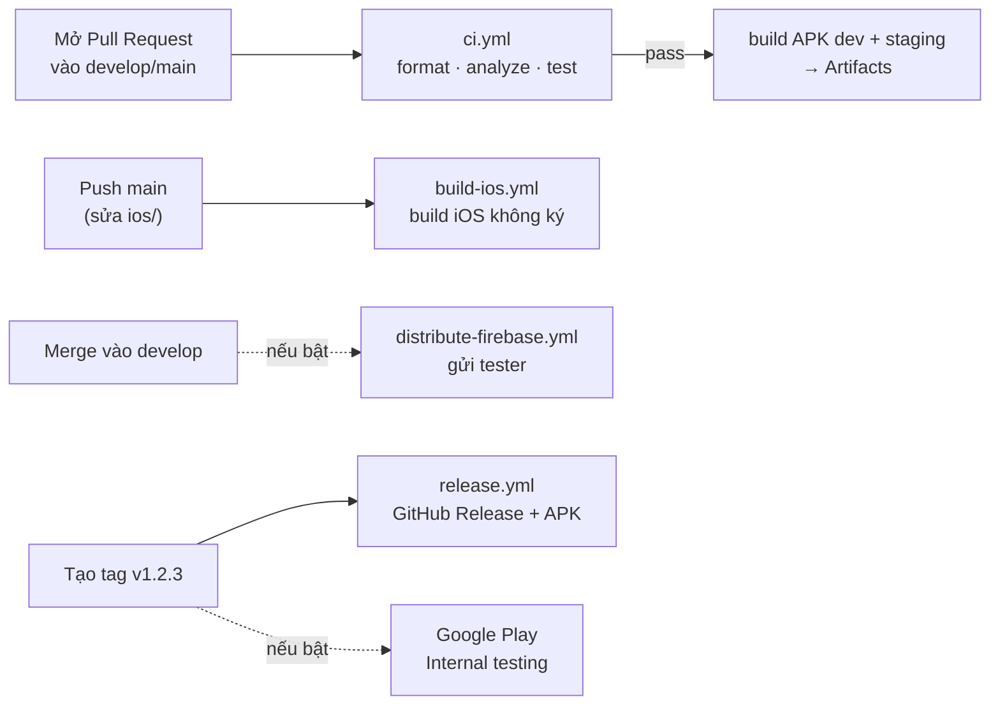

# CI/CD cho SmartOmni Mobile

## 1. CI/CD là gì? (giải thích cho người mới)

Hãy tưởng tượng có một "người kiểm tra tự động" đứng ở cửa nhánh `develop` và `main`:

- **CI - Continuous Integration (tích hợp liên tục):** mỗi khi có người mở Pull Request, GitHub tự bật một máy ảo, tải code về và chạy: kiểm tra format → phân tích lỗi → chạy test → build thử APK. Có lỗi thì PR hiện ❌ đỏ, không nên merge. Nhờ vậy lỗi bị chặn **trước** khi vào code chung, và không còn cảnh "máy em chạy được mà".
- **CD - Continuous Delivery (phân phối liên tục):** khi code đã ổn, GitHub tự build file cài đặt và **gửi đi** (cho tester, lên Google Play...) thay vì bạn build tay rồi gửi qua Zalo.

Mọi thứ được viết trong các file `.github/workflows/*.yml`. GitHub đọc các file này và chạy trên máy của GitHub (gọi là **GitHub Actions**).

**Chi phí: 0đ.** Repo của bạn là **public** nên GitHub Actions miễn phí không giới hạn, kể cả máy macOS. (Nếu sau này chuyển repo sang private: miễn phí 2.000 phút/tháng, máy macOS tính gấp 10 lần.)

## 2. Các workflow đang có



| File | Chạy khi | Làm gì | Trạng thái |
|---|---|---|---|
| `ci.yml` | PR / push vào `develop`, `main`; bấm tay | Format, analyze, test + coverage; build APK dev & staging | ✅ **Bật** (mức 1) |
| `build-ios.yml` | Bấm tay; push `main` có sửa `ios/` | Build iOS `--no-codesign` trên macOS để chắc chắn compile được | ✅ Bật (chạy tay) |
| `release.yml` → job `github-release` | Push tag `v*.*.*` | Build APK prod, tạo **GitHub Release** đính kèm APK | ✅ Bật (miễn phí) |
| `distribute-firebase.yml` | Push `develop` | Gửi APK staging cho tester qua Firebase App Distribution | ⏸️ **Tắt** (mức 2) |
| `release.yml` → job `google-play` | Push tag `v*.*.*` | Đẩy AAB lên Google Play kênh Internal | ⏸️ **Tắt** (mức 3) |
| `dependabot.yml` | Hàng tuần | Tự mở PR nâng cấp thư viện | ✅ Bật |

### Xem kết quả và tải APK
1. Vào repo trên GitHub → tab **Actions**.
2. Bấm vào lần chạy (ví dụ "CI") → xem từng bước, bước đỏ là lỗi, bấm vào để đọc log.
3. Kéo xuống cuối trang → **Artifacts** → tải `smartomni-apk-<số>` (file zip chứa APK) → giải nén → gửi sang điện thoại Android → cài.

### Chạy tay một workflow
Tab **Actions** → chọn workflow bên trái (vd: "iOS build check") → nút **Run workflow** → chọn nhánh → **Run**.

## 3. Mức 1 - đang dùng (không cần chuẩn bị gì)

Việc duy nhất nên làm: **bật bảo vệ nhánh** để bắt buộc CI xanh mới được merge.
Settings → Branches → **Add branch ruleset** (hoặc *Add rule*) cho `main` và `develop`:
- Require a pull request before merging
- Require status checks to pass → chọn `Format · Analyze · Test`, `Build APK (dev + staging)`

### Phát hành một phiên bản (miễn phí, qua GitHub Release)
```bash
# Tăng version trong pubspec.yaml, vd: version: 0.2.0+1, commit lên main, rồi:
git switch main && git pull
git tag v0.2.0
git push origin v0.2.0
```
→ Workflow **Release** chạy → trang **Releases** của repo có file `app-prod-release.apk` để tải.

## 4. Tạo keystore (chữ ký app) - cần cho mức 2 và 3

App Android phải được **ký**. Hiện CI ký bằng *debug key* (cài thử được, nhưng **không** đưa lên Google Play được và mỗi máy build có key khác nhau → không cài đè được).

1. Tạo keystore **một lần** (trên Mac):
   ```bash
   keytool -genkey -v -keystore ~/smartomni-upload.jks \
     -keyalg RSA -keysize 2048 -validity 10000 -alias upload
   ```
   Ghi lại mật khẩu. **Cất file `.jks` + mật khẩu ở nơi an toàn** (mất là không cập nhật được app trên Google Play).
2. Dùng ở máy mình: tạo `android/key.properties` (đã nằm trong `.gitignore`, **không commit**):
   ```properties
   storePassword=<mật khẩu>
   keyPassword=<mật khẩu>
   keyAlias=upload
   storeFile=/Users/<ban>/smartomni-upload.jks
   ```
3. Đưa lên GitHub Secrets: repo → Settings → **Secrets and variables → Actions → New repository secret**:

| Secret | Giá trị |
|---|---|
| `ANDROID_KEYSTORE_BASE64` | Kết quả `base64 -i ~/smartomni-upload.jks \| pbcopy` (đã copy vào clipboard) |
| `ANDROID_KEYSTORE_PASSWORD` | Mật khẩu keystore |
| `ANDROID_KEY_ALIAS` | `upload` |
| `ANDROID_KEY_PASSWORD` | Mật khẩu key |

Có các secret này, `release.yml` tự ký bằng key thật.

## 5. Bật mức 2 - gửi bản test qua Firebase App Distribution (miễn phí)

Tester nhận email/app Firebase, bấm cài là xong, không cần gửi file tay.

1. Vào https://console.firebase.google.com → **Add project** (tắt Google Analytics cho nhanh).
2. **Add app → Android**, package name `com.smartomni.mobile.stg` (flavor staging). Bỏ qua bước tải `google-services.json` (app chưa dùng Firebase SDK).
3. Project settings → General → copy **App ID** (dạng `1:123:android:abc`).
4. Menu **App Distribution** → Get started → tab **Testers & Groups** → tạo group tên **`testers`**, thêm email tester.
5. Tạo service account: Project settings → **Service accounts** → *Manage service account permissions* (mở Google Cloud) → **Create service account** → role **Firebase App Distribution Admin** → tab Keys → **Add key → JSON** → tải file.
6. GitHub Secrets thêm:
   - `FIREBASE_APP_ID_ANDROID_STAGING` = App ID ở bước 3
   - `FIREBASE_SERVICE_ACCOUNT_JSON` = toàn bộ nội dung file JSON
   - cùng 4 secret keystore ở mục 4
7. Bật: Settings → Secrets and variables → Actions → tab **Variables** → **New repository variable**: `ENABLE_FIREBASE_DISTRIBUTION` = `true`.

Từ giờ mỗi lần merge vào `develop`, tester nhận bản mới.

## 6. Bật mức 3 - Google Play Internal testing (tốn 25 USD một lần)

1. Đăng ký **Google Play Console** (25 USD, một lần): https://play.google.com/console.
2. Tạo app mới, package `com.smartomni.mobile`. **Lần upload đầu tiên phải làm tay**: build `flutter build appbundle --flavor prod -t lib/main_prod.dart` (ký bằng keystore mục 4) → upload vào *Testing → Internal testing*.
3. Tạo service account Google Cloud có quyền với Play Console (Users and permissions → mời email service account, quyền *Release to testing tracks*) → tải key JSON.
4. GitHub Secret: `PLAY_SERVICE_ACCOUNT_JSON` = nội dung file JSON.
5. Variable: `ENABLE_PLAY_RELEASE` = `true`.
6. Từ giờ tạo tag `vX.Y.Z` → AAB tự lên Internal testing ở trạng thái *draft* để bạn bấm phát hành.

## 7. iOS - phát hành cần gì?

| Mục tiêu | Cần | Chi phí |
|---|---|---|
| Kiểm tra code iOS compile được | `build-ios.yml` (đã có) | 0đ |
| Chạy trên iPhone của bạn | Mac + Xcode + Apple ID thường ([SETUP.md](SETUP.md) mục 3) | 0đ (app hết hạn sau 7 ngày) |
| Gửi bản test cho người khác (TestFlight) / App Store | Apple Developer Program | 99 USD/năm |

Khi có tài khoản Apple Developer, có thể thêm workflow ký và upload TestFlight (dùng `fastlane match` hoặc `apple-actions/import-codesign-certs`). Sẽ bổ sung khi cần.

## 8. Khi CI báo đỏ - sửa thế nào?

| Bước lỗi | Ý nghĩa | Cách sửa ở máy |
|---|---|---|
| Kiểm tra format | Code chưa được format | `dart format lib test` → commit |
| Phân tích code | Có lỗi/cảnh báo | `flutter analyze` → sửa theo gợi ý |
| Chạy test | Test fail | `flutter test` → đọc dòng `Expected / Actual` |
| Build APK | Lỗi Gradle/Android | Chạy lệnh build tương tự ở máy, đọc log |
