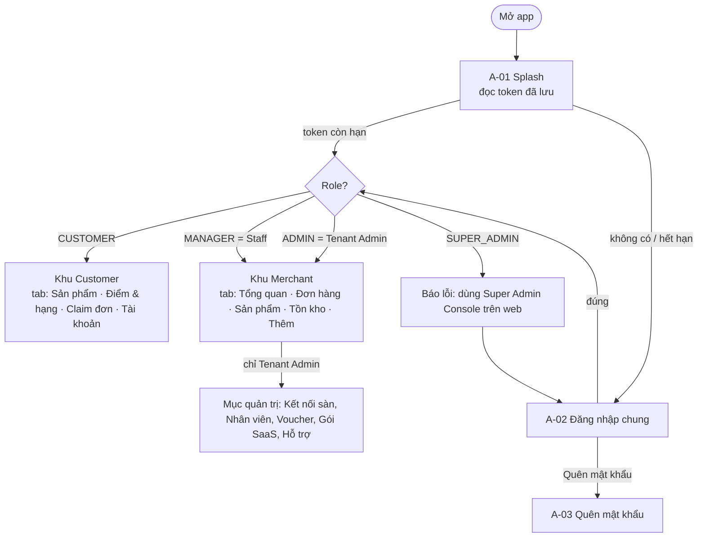
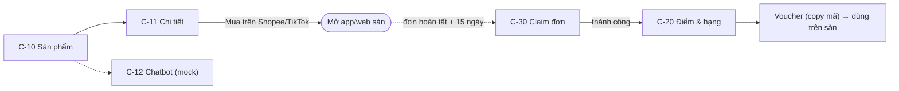
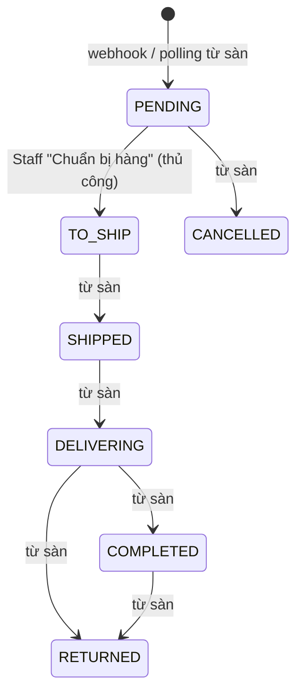
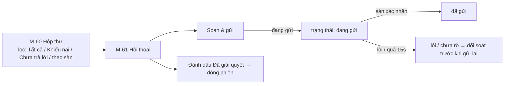

# User flows theo role

> Đây là **đầu vào cho bước thiết kế giao diện**. Mỗi flow ghi rõ: màn hình, thao tác, dữ liệu hiển thị, trạng thái lỗi/rỗng và API (✅ thật / 🟡 mock / ⚪ chưa có).
> Mã màn hình (`A-01`, `M-10`, `C-20`...) dùng để tham chiếu khi vẽ wireframe và khi đặt tên file.

## 0. Bản đồ tổng thể

### Danh sách màn hình

| Mã | Màn hình | Role | Trạng thái code |
|---|---|---|---|
| A-01 | Splash | Tất cả | ✅ |
| A-02 | Đăng nhập chung | Tất cả | ✅ |
| A-03 | Quên mật khẩu (gửi email) | Tất cả | ✅ |
| A-04 | Đặt lại mật khẩu (mã + mật khẩu mới) | Tất cả | ✅ |
| A-05 | Đăng ký tài khoản khách (+ OTP email) | Customer | ✅ (mock) |
| C-00 | Chọn cửa hàng / thêm cửa hàng (1 khách nhiều cửa hàng) | Customer | ✅ (mock) |
| C-10 | Storefront - danh sách sản phẩm | Customer | ✅ (mock) |
| C-11 | Chi tiết sản phẩm + nút mua trên sàn | Customer | ✅ (mock) |
| C-12 | Chatbot tư vấn | Customer | ✅ (mock) |
| C-20 | Điểm & hạng + lịch sử + voucher | Customer | ✅ (mock) |
| C-30 | Claim đơn | Customer | ✅ (mock) |
| C-40 | Tài khoản | Customer | ✅ (khung) |
| M-10 | Tổng quan (Staff: việc hôm nay / Admin: tổng quan cửa hàng) | Staff, Admin | ✅ (mock) |
| M-20 | Danh sách đơn | Staff, Admin | ✅ |
| M-21 | Chi tiết đơn | Staff, Admin | ✅ |
| M-22 | In vận đơn | Staff, Admin | 🟡 |
| M-30 | Danh sách sản phẩm | Staff, Admin | ✅ (mock list) |
| M-31 | Chi tiết sản phẩm + SKU | Staff, Admin | ✅ |
| M-32 | Tạo / sửa sản phẩm | Staff, Admin | ✅ tạo (1 SKU) |
| M-40 | Tồn kho + đặt lại số lượng | Staff, Admin | ✅ (mock list) |
| M-50 | Thêm (menu) | Staff, Admin | ✅ |
| M-51 | AI: chọn SKU → dự báo nhu cầu | Staff, Admin | ✅ |
| M-60 | Hộp thư CSKH | Staff, Admin | ✅ (mock) |
| M-61 | Chi tiết hội thoại | Staff, Admin | ✅ (mock) |
| T-10 | Kết nối sàn | Admin | ✅ |
| T-20 | Quản lý nhân viên | Admin | ⚪ |
| T-30 | Phát voucher | Admin | ⚪ |
| T-40 | Gói dịch vụ SaaS | Admin | ⚪ |
| T-50 | Yêu cầu hỗ trợ | Admin | ⚪ |

---

## 1. Flow chung (mọi role)

### F-A1. Mở app và khôi phục phiên
1. **A-01 Splash** hiển thị logo + vòng tải.
2. App đọc JWT trong bộ nhớ an toàn.
3. Token còn hạn và role hợp lệ → vào trang chủ của role (bỏ qua đăng nhập).
4. Không có token / hết hạn / role không hỗ trợ → xóa token → **A-02**.

### F-A2. Đăng nhập
| Bước | Người dùng | Hệ thống |
|---|---|---|
| 1 | Nhập email, mật khẩu, bấm **Đăng nhập** | Validate: email đúng định dạng, mật khẩu không trống |
| 2 | | `POST /api/auth/login` ✅ - nút chuyển trạng thái loading, khóa bấm lặp |
| 3a | | Thành công → lưu token → điều hướng theo role |
| 3b | | Sai → hiện lỗi dưới form: "Email hoặc mật khẩu không đúng" |
| 3c | | Sai 5 lần → BE khóa 15 phút: "Tài khoản tạm khóa…" |
| 3d | | Tài khoản bị vô hiệu / tenant bị khóa → thông báo tương ứng |
| 3e | | Super Admin → "Tài khoản này không dùng được trên app mobile…" |

Cần thiết kế: logo, ô nhập có icon hiện/ẩn mật khẩu, link "Quên mật khẩu?", vùng thông báo lỗi, (sau này) link "Đăng ký tài khoản khách".

### F-A3. Quên / đặt lại mật khẩu
1. **A-03**: nhập email → `POST /api/auth/forgot-password` ✅ → luôn báo "Nếu email tồn tại, hướng dẫn đã được gửi" (không tiết lộ email có tồn tại).
2. **A-04**: nhập **mã xác nhận** (token trong email) + mật khẩu mới ≥ 8 ký tự → `POST /api/auth/reset-password` ✅.
3. Thành công → về A-02 với thông báo "Đã đặt lại mật khẩu".
4. Lỗi: mã sai / đã dùng / hết hạn (30 phút).

> Gợi ý thiết kế sau: nhận link trong email mở thẳng app (deep link) thay vì gõ mã.

### F-A4. Phiên hết hạn / đăng xuất
- Bất kỳ API nào trả **401** → app xóa token → về A-02 kèm dòng "Phiên đăng nhập đã hết hạn".
- Đăng xuất: tab Tài khoản / Thêm → **Đăng xuất** → hộp thoại xác nhận → `POST /api/auth/logout` → A-02.

---

## 2. Customer

### F-C1. Khám phá sản phẩm và mua trên sàn
| Bước | Màn hình | Nội dung / thao tác | API |
|---|---|---|---|
| 1 | C-10 | Lưới sản phẩm: ảnh, tên, giá "Từ …₫". Kéo để làm mới. (Sau: tìm kiếm, lọc danh mục) | 🟡 `GET /api/storefront/products` |
| 2 | C-11 | Ảnh lớn, tên, giá, mô tả, các phân loại (SKU) | 🟡 |
| 3 | C-11 | Nút **Mua trên Shopee** / **Mua trên TikTok Shop** - chỉ hiện sàn có URL | - |
| 4 | | Mở app sàn (nếu cài) hoặc trình duyệt. **Không có giỏ hàng/thanh toán trong SmartOmni** | - |

Trạng thái: đang tải (skeleton), rỗng ("Cửa hàng chưa có sản phẩm"), lỗi + thử lại, sản phẩm chưa mở bán trên sàn nào.

### F-C2. Hỏi chatbot (mock)
Nút "Hỏi AI" trên thanh của C-10 → **C-12** khung chat với AI tư vấn sản phẩm; AI có thể gợi ý sản phẩm (thẻ sản phẩm bấm được → C-11). Chưa có API.

### F-C3. Claim đơn tích điểm
| Bước | Người dùng | Hệ thống |
|---|---|---|
| 1 | Mở tab **Claim đơn** (C-30) | Hiển thị điều kiện: đơn hoàn tất ≥ 15 ngày, mỗi đơn 1 lần |
| 2 | Chọn sàn (Shopee / TikTok Shop), nhập **mã đơn** | Validate không trống |
| 3 | Bấm **Claim điểm** | 🟡 `POST /api/customer/claims` - khóa nút khi đang gửi |
| 4a | | Thành công: "Bạn được cộng **520** điểm" (+ hạng mới nếu lên hạng) |
| 4b | | Không tìm thấy đơn trong shop đã chọn |
| 4c | | Đơn chưa được sàn xác nhận hoàn tất |
| 4d | | Chưa đủ 15 ngày (nên hiển thị ngày được claim) |
| 4e | | Đơn đã được claim |
| 4f | | Thử sai quá nhiều lần → tạm khóa (BE quyết định ngưỡng) |

Quy tắc hiển thị: điểm = `floor(tiền hàng thực trả / 1.000₫)`, không tính ship/thuế.

> Gợi ý thiết kế: thêm hướng dẫn "Tìm mã đơn ở đâu trên Shopee/TikTok" (ảnh minh họa), nút dán (paste) mã.

### F-C4. Xem điểm, hạng, voucher
**C-20** gồm:
1. Thẻ hạng: tên hạng (Standard / Silver / Platinum / Diamond), tổng điểm, thanh tiến độ, "Còn X điểm để lên hạng Y".
2. Quy tắc tích điểm (ngắn gọn).
3. **Voucher của bạn**: mã, sàn áp dụng, mô tả, hạn dùng, nút **Sao chép mã**. Khách dùng mã trên app sàn. (Voucher do Tenant Admin chủ động phát, khách **không** đổi điểm lấy thưởng.)
4. **Lịch sử tích điểm**: mã đơn, sàn, ngày claim, +điểm.

### F-C5. Tài khoản
C-40: thông tin (email, SĐT), đổi mật khẩu ⚪, sửa thông tin ⚪, đăng xuất ✅.

### F-C6. Đăng ký tài khoản khách ⚪
A-02 → "Chưa có tài khoản? Đăng ký" → A-05: họ tên, email, SĐT, mật khẩu, mã cửa hàng (nhập hoặc quét QR; **đã chốt: 1 khách dùng nhiều cửa hàng**, thêm cửa hàng khác sau ở C-00) → xác minh OTP qua email (6 số, gửi lại sau 45 giây) → vào C-10 của cửa hàng vừa tham gia.

---

## 3. Staff

Thanh điều hướng dưới: **Tổng quan · Đơn hàng · Sản phẩm · Tồn kho · Thêm**.

### F-S1. Bắt đầu ngày làm việc (M-10 "Việc hôm nay")
- Thẻ số liệu: Đơn hôm nay, **Chờ xử lý**, SKU sắp hết. (Staff **không** thấy doanh thu.)
- **Cảnh báo AI**: sắp hết hàng, giá chênh lệch bất thường giữa sàn, nhu cầu tăng. Bấm cảnh báo → màn liên quan (SKU / sản phẩm) - *cần thiết kế điều hướng*.
- (Sau) Banner cảnh báo **kết nối sàn lỗi / hết quyền**.
- API: 🟡 dashboard, 🟡 `GET /api/ai/alerts`.

### F-S2. Xử lý đơn hàng

| Bước | Màn hình | Nội dung / thao tác | API |
|---|---|---|---|
| 1 | M-20 | Danh sách đơn: logo sàn, mã đơn, khách, thời gian, tổng tiền, trạng thái. Lọc theo trạng thái (chip). Kéo làm mới. (Sau: lọc theo sàn, tìm mã đơn, tải thêm khi cuộn) | ✅ `GET /api/orders` |
| 2 | M-21 | Chi tiết: sàn, trạng thái, tổng tiền, khách, SĐT (che bớt), địa chỉ, danh sách sản phẩm | ✅ (items 🟡) |
| 3 | M-21 | Nút **Chuyển sang "Chờ giao"** - chỉ hiện khi đơn PENDING | ✅ `PATCH /api/orders/{id}/status` |
| 4 | M-22 | **In vận đơn** PDF → xem / chia sẻ / in (từ Chờ giao trở đi) | 🟡 |
| 5 | M-21 | **Ghi nhận hoàn/trả**: hộp thoại nhập lý do | ✅ `POST /api/returns` |

Quy tắc: Staff **không** tự đánh dấu Hoàn tất / Trả hàng / Hủy (đồng bộ từ sàn) - giao diện không có nút cho các trạng thái này.
Trạng thái lỗi: mất mạng, đơn đã được người khác xử lý (BE trả lỗi), không có quyền.

### F-S3. Quản lý sản phẩm
| Bước | Màn hình | Nội dung / thao tác | API |
|---|---|---|---|
| 1 | M-30 | Danh sách: tên, số SKU, giá từ, trạng thái Ẩn. Nút **+ Thêm sản phẩm** | 🟡 list |
| 2 | M-31 | Chi tiết: mô tả, danh sách SKU (biến thể, mã, giá), liên kết sàn. Bấm SKU → dự báo AI (M-51) | ✅ |
| 3 | M-32 | Tạo: tên*, mô tả, SKU đầu tiên (mã*, biến thể, giá*) → Lưu | ✅ `POST /api/products` |
| 4 | M-32 (sau) | Nhiều SKU, upload ảnh, dán URL sản phẩm Shopee/TikTok, ẩn/hiện, sửa giá theo kênh | ⚪ |

### F-S4. Tồn kho
| Bước | Màn hình | Nội dung / thao tác | API |
|---|---|---|---|
| 1 | M-40 | Danh sách SKU: tên sản phẩm, biến thể, mã SKU, **có thể bán** (= tồn - giữ chỗ), tồn thực tế, giữ chỗ. Màu: hết hàng (đỏ), sắp hết ≤ 5 (cam). Lọc "Sắp hết" | 🟡 list |
| 2 | M-40 | Bấm SKU → hộp thoại **Đặt lại số lượng tồn** (số tồn **mới**, ≥ 0) | ✅ `POST /api/inventory/{skuId}/adjust` |
| 3 | | Thành công: "Đã cập nhật… Hệ thống sẽ đồng bộ lên sàn" | outbox BE |

> Gợi ý: sau này thêm quét mã vạch SKU bằng camera, lịch sử điều chỉnh tồn.

### F-S5. Xem dự báo AI
M-50 → **AI dự báo & gợi ý** → M-51 chọn SKU → dự báo 7 ngày: tổng dự kiến bán, gợi ý số lượng nhập thêm, danh sách theo ngày. ✅ `GET /api/ai/forecast/{skuId}`. (Sau: biểu đồ, gợi ý sản phẩm liên quan `GET /api/ai/recommendations/{skuId}`.)

### F-S6. Hộp thư CSKH ⚪ (thiết kế trước, chờ API)

- Mỗi hội thoại gắn nhãn AI: **Bình thường** / **Khiếu nại (khóa)** / **Cần kiểm tra**. AI **không** soạn hay gửi thay.
- Hiển thị đơn liên quan của khách (cùng sàn + shop) nếu xác minh được ID.
- Nội dung: văn bản, ảnh, video, tệp, sticker, thẻ sản phẩm, thẻ đơn - loại nào sàn không hỗ trợ thì hiện "Không xem được nội dung này".
- Nhiều Staff cùng mở được; mỗi tin ghi người gửi + thời gian.

### F-S7. Tài khoản (tab Thêm - M-50)
Hồ sơ (email, role, cửa hàng, môi trường), AI dự báo, Hộp thư ⚪, Danh sách hoàn/trả ⚪, Đăng xuất.

---

## 4. Tenant Admin

Có **toàn bộ flow của Staff**, thêm:

### F-T1. Tổng quan cửa hàng (M-10 bản Admin)
- Thẻ số liệu như Staff + **Doanh thu hôm nay**.
- **Doanh thu theo kênh** (Shopee vs TikTok Shop).
- (Ưu tiên tiếp theo của dự án) biểu đồ doanh thu 7/30 ngày, top sản phẩm, tỷ lệ hủy/hoàn, **AI tư vấn chiến lược kinh doanh**.
- API 🟡 (chưa có BI).

### F-T2. Kết nối sàn (T-10)
| Bước | Nội dung | API |
|---|---|---|
| 1 | Hai thẻ: Shopee, TikTok Shop - trạng thái: Chưa kết nối / Đã kết nối (shop ID) / Lỗi - cần kết nối lại / Đã ngắt | 🟡 list |
| 2 | Bấm **Kết nối** → bottom sheet: App Key, App Secret, công tắc "Tự động nhập sản phẩm" | |
| 3 | Gửi → thành công / lỗi (vd: "Mỗi sàn chỉ 1 shop") | ✅ `POST /api/marketplace-connections` |

> Thực tế Shopee/TikTok dùng OAuth (mở trang sàn để cấp quyền). Khi BE làm OAuth, flow đổi thành: bấm Kết nối → mở trình duyệt → đăng nhập sàn → quay về app.

### F-T3. Quản lý nhân viên (T-20) ⚪
Danh sách Staff (tên, email, trạng thái) → Mời/Tạo Staff (email, mật khẩu tạm) → Vô hiệu hóa / kích hoạt lại. (Chưa chốt Staff có quyền con.)

### F-T4. Phát voucher cho khách (T-30) ⚪
1. Chọn đối tượng: theo **hạng** (Silver trở lên…) hoặc chọn từng khách.
2. Chọn sàn/shop, cấu hình voucher (giá trị, đơn tối thiểu, hạn dùng - tùy API sàn).
3. Xác nhận → SmartOmni gọi API sàn tạo voucher → **chỉ gửi email cho khách khi sàn xác nhận tạo thành công**.
4. Theo dõi trạng thái: đang tạo / thành công / lỗi / chưa rõ (cần đối soát, không tạo lại).
5. Nếu sàn không cho tạo voucher qua API → chức năng ẩn/khóa cho sàn đó.

### F-T5. Gói dịch vụ SaaS (T-40) ⚪
Gói hiện tại, giới hạn (số SKU, số kết nối, dung lượng) và mức đã dùng, nâng/hạ cấp, lịch sử hóa đơn, thanh toán.

### F-T6. Yêu cầu hỗ trợ (T-50) ⚪
Tạo ticket (tiêu đề, mô tả) → danh sách ticket + trạng thái (Mở / Đang xử lý / Đã giải quyết).

### F-T7. Đăng ký cửa hàng mới ⚪
Có thể làm trên mobile: A-02 → "Mở cửa hàng" → tên cửa hàng, subdomain, email, mật khẩu → `POST /api/tenants/onboarding` ✅ → đăng nhập. (Cần chốt có làm trên mobile hay chỉ web.)

---

## 5. Yêu cầu chung cho thiết kế

| Hạng mục | Yêu cầu |
|---|---|
| Trạng thái màn hình | Mỗi màn có 4 trạng thái: đang tải (skeleton), có dữ liệu, rỗng, lỗi + Thử lại |
| Thao tác ghi | Nút khóa khi đang gửi; thông báo thành công/thất bại (SnackBar); hỏi xác nhận với thao tác quan trọng |
| Phân biệt sàn | Màu/logo riêng cho Shopee và TikTok Shop xuyên suốt (đơn, sản phẩm, voucher, hội thoại) |
| Trạng thái đơn | Bộ màu badge cho 7 trạng thái |
| Hạng khách | Bộ màu/biểu tượng cho 4 hạng |
| Tiền tệ, ngày | `1.250.000 ₫`, `dd/MM/yyyy HH:mm` |
| Dark mode | Nên hỗ trợ (theme đã có sẵn chế độ tối) |
| Ngôn ngữ | Tiếng Việt mặc định, chữ có dấu dài hơn - thiết kế chừa chỗ |
| Kích thước | Ưu tiên điện thoại (iPhone 14 Plus 428×926 pt, Android 360-412 dp); chưa cần tablet |
| Dữ liệu mẫu | Màn dùng mock có dải "Dữ liệu mẫu" - sẽ bỏ khi có API thật |
